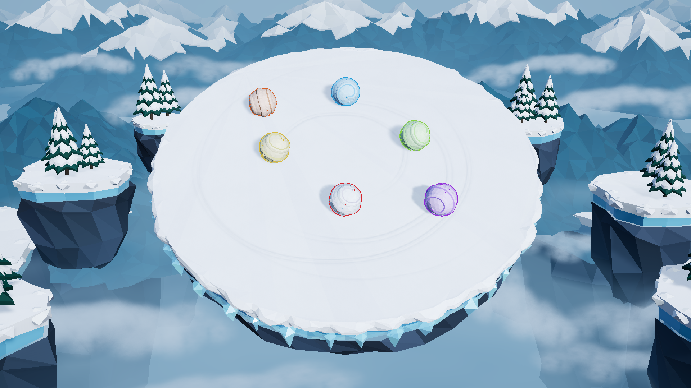
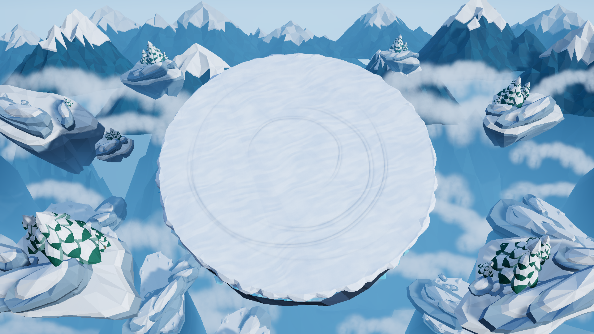
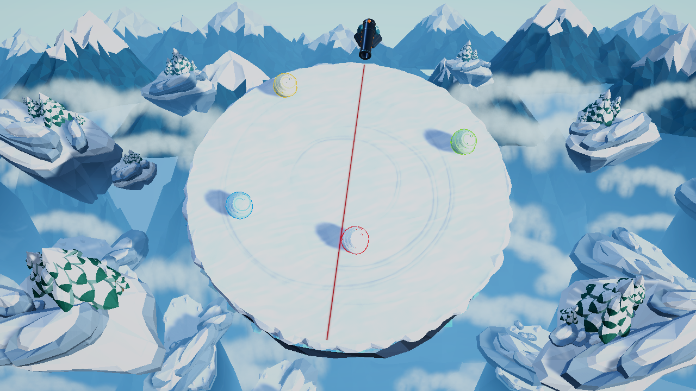
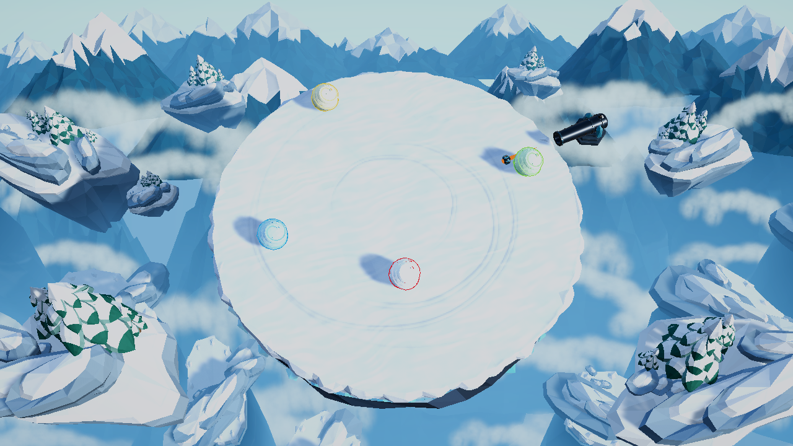

# 决战雪山之巅

一个在雪山顶上滚雪球的多人混战小游戏。球会随着滚动不断变大变重，把对手撞下平台，活到最后的人获胜。20 秒后山顶的炮台开始轰击平台，逼所有人动起来。



Unity 6000.3.28f1 / URP。Windows 平台，键盘操作。

## 玩法

开局所有人从平台边缘出生，大小一致。

- **滚雪球**：在雪地上移动就会粘雪变大，质量随之增加
- **撞击**：球之间会互相推挤，重的撞轻的能把人顶出去
- **炮击**：20 秒后平台边缘出现炮台，沿直径方向开火，被命中的球直接出局
- **获胜**：最后一个留在平台上的人赢

开局依次经过首页、三图教程和人数选择。首页点击“开始游戏”或按 `Enter` 查看教程；教程点击任意处或按 `Enter` 继续；人数选择支持 0～15 个机器人，点击“现在开始吧！”或按 `Enter` 开局，0 人时显示“开始练习”。

操作：`WASD` 移动，`←→` 或加减按钮在人数选择页调整机器人数量，`Enter` 开局，`Esc` 返回首页，出局后 `R` 重开。



平台是一个悬在雪山之间的圆形雪地，边缘没有围栏，掉下去就出局。出生点均匀分在边上，所以开局通常先往中间走——中间空间大，能滚得更久。

## 设计

### 重量系统

雪球的质量不是随体积线性增长的，而是用了一个略大于 1 的指数：

```
质量 = 初始质量 × (体积 / 初始体积) ^ 1.35
```

线性模型（指数为 1）下，体积翻倍只是质量翻倍，滚得早的一方优势不够明显。指数拉到 1.35 之后，体积翻四倍，质量会变成六倍半——**滚得久的人在碰撞里获得实实在在的碾压感**，而不只是"稍微大一点"。

代价是大球会变得迟钝。所以驱动力也跟着质量上调，保持操控性：球越大，绝对推力越强，只是加速度仍然在降。这样后期玩家不会因为"球太重动不了"而失去操作感，但物理上的惯性依然真实。

### 碰撞

碰撞全部交给物理引擎，只有一条人为约束：**球和球之间不允许弹出向上的速度**。

这条规则是整个手感的基础。早期版本弹性调得很高，结果等质量的两个球相撞会"互换速度"，弹开又撞回来，谁也推不动谁，对局陷入僵持。把球间的恢复系数压到 0.3（球和地面是 0.05）之后，撞击的能量被吸收，横向推挤成为主要结果。

另外，因为平台只有十几米，50 m/s 的球在一个物理步里能移动将近 1 米——足以让球直接穿过对手，然后因为穿透修正被弹飞。物理步长从 60 Hz 提到 120 Hz 就是为了让高速碰撞不再穿透。

如果不限制向上弹射，胜负就会变成"谁运气好弹得高"，而不是位置和体重的博弈。把球按在平台平面上互相顶，是这套手感能成立的前提。

### 大炮



20 秒时第一台炮台出现在平台边缘，40 秒、60 秒各增一台，最多三台。

炮台的火线是一条**穿过平台中心的直径**，而不是瞄准某个人。这个设计是有意的：

- 瞄准领先者会让游戏变成"谁大谁挨打"的惩罚机制，滚雪球反而变成负收益
- 固定直径线对所有人是平等的威胁，谁站在线上谁就要跑
- 预警是三次闪烁，从部署到开火有 3 秒——足够跑开，但不够犹豫

炮弹命中即出局，不产生击退，命中后炮弹立刻消失，所以一枚炮弹只能杀一个人。这样炮击是"清场工具"而不是"群体伤害"。



### 机器人

机器人共享和玩家完全一样的控制曲线和物理，所以它们被撞也一样会被撞飞。区别只在决策。

基本行为是追击和绕行，此外有几条专门的判断：

- **蓄势**：对手明显比自己重、而自己速度不够时，先后退拉开距离再加速冲撞，而不是硬顶
- **闪避**：被明显更重的球高速冲来时侧向让开，让对方把速度浪费掉
- **脱离**：几个球低速顶在一起时主动退出球堆，避免僵持
- **躲炮**：预警线就是炮弹的精确弹道，站在线上就横向走出去

躲炮这条几乎是免费的——线是画出来的，避开它不需要预判。

### 认出自己的球

不做任何文字提示，全靠视觉：

- 玩家的描边是**暖橙色**，机器人被限制在冷色系（蓝/青/紫/绿），两族不会撞色
- 玩家脚下有一块贴地的光斑，每局开始时由大收缩、由亮转柔，把视线吸过去
- 球体本身带一点点暖色，所以只看球也能和自己的机器人队友区分

光斑用的是 alpha 混合而不是加色混合：雪地接近纯白，加色混合会直接饱和成白色，看上去就是"没有光斑"。

### 反馈

碰撞反馈是分级的，按接近速度决定强度：

- 轻碰：音效 + 一小片雪雾
- 重撞：加镜头的轻微抖动
- 全力相撞：额外的雪雾、镜头震动，以及二十几毫秒的顿帧

**只有玩家参与的碰撞才享受完整待遇**。机器人之间的互撞只有音效和雪雾，没有镜头动作和顿帧——否则满场都在震，真正属于玩家的那一下就没有分量了。

球被撞的瞬间，接触面会凹陷再弹回。凹陷的大小、范围和停留时间都由撞击强度决定：轻推只是一小块浅浅的坑，瞬间回弹；全速对撞会压掉大半个接触面，停住三分之一秒再带过冲弹回来。

### 获胜

赢的那一刻不会直接弹结算面板。画面会暗下来，一束聚光灯打在获胜者身上并跟着它走，玩家还有三秒可以随便开——这三秒是给玩家自己看的，用来确认"这个是我赢的"。

变暗是通过压低场景的环境光实现的，不是压后处理的曝光。曝光是全局的，压下去连聚光灯照亮的球一起变暗，获胜者会变成一个没有颜色的黑影。

## 运行

**编辑器**：用 Unity Hub 以 6000.3.28f1 打开项目，加载 `Assets/SnowballArena/Scenes/Match.unity`，按 Play。

**构建**：菜单 `Snowball Arena → Build Windows Game`，产物在 `Builds/Windows/`。

主菜单可以选 0～15 个机器人，0 是自由练习，可以自己摸索操作和观察炮击节奏。

## 验证

测试没有用 Unity Test Framework，而是几个跑在真实物理和场景里的运行时探针：

```bash
# 碰撞、成长、质量模型
Unity.exe -batchmode -quit -projectPath . \
  -executeMethod SnowballArena.Editor.GrowthCollisionValidation.Run

# 完整对局流程（需要先构建）
Builds/Windows/SnowballArena.exe --match-smoke TestResults/match-smoke

# 炮台计时、预警、命中、升级
Builds/Windows/SnowballArena.exe --cannon-smoke TestResults/cannon-smoke
```

探针会把结果写成 JSON 和截图，失败时返回非零退出码。

## 更多

实现细节、参数含义和调参记录都在 [docs/technical-notes.md](docs/technical-notes.md)。美术资源的来源与复现方式见 [docs/art/README.md](docs/art/README.md)。

## 许可

手写界面素材、资源制作方式与实机审阅说明见 [UI 文档](docs/ui/README.md)。备用字体霞鹜漫黑的 OFL 1.1 授权见 [字体许可](Assets/Resources/UI/OFL.txt)。

程序与自制资源为本项目所有。第三方音频与模型素材的逐项许可见 [Assets/SnowballArena/Audio/LICENSE.txt](Assets/SnowballArena/Audio/LICENSE.txt) 和 [docs/art/README.md](docs/art/README.md)，其中大部分为 CC0，炮击与爆炸音效含 **CC-BY 3.0** 素材，需要保留署名。
