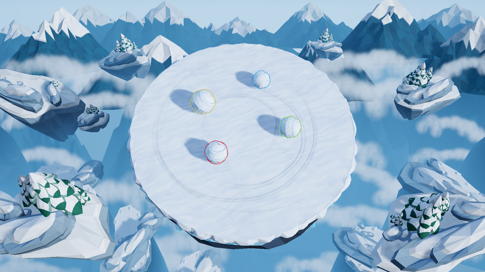

# 雪山滚雪球

Windows 本地单机首版，Unity **6000.3.28f1** / URP / Input System。

## 运行

使用下文的构建菜单生成 `Builds/Windows/SnowballArena.exe`，然后双击运行并点击游戏窗口使其获得键盘焦点。必须保留同目录的 Data、MonoBleedingEdge 等运行依赖，不要只复制 exe。构建产物不进入 Git。

在 Unity 中打开 `Assets/SnowballArena/Scenes/Match.unity` 后点击 Play。原模板 SampleScene 和物理练习场 Arena 都保留。

## 操作

- 主菜单：← / → 选择 0～15 个机器人，Enter 开始；也可以点击加减按钮。
- 比赛：WASD 控制红色描边的白色雪球；斜向输入归一化。雪球按镜头方向移动，具有惯性。
- Esc：返回菜单。
- 出局或结算后：R 重新开始；玩家出局后其余雪球继续比赛，可观战。
- 0 个机器人：自由练习，掉落后结算。

1 名真人与所选数量的机器人在同一个平台上比赛；最后存活者获胜。同一物理步内全部落台则判平局。

所有正式参赛雪球初始半径、密度、驱动力和成长参数相同。机器人只输出移动方向，不获得额外力度，不直接设置速度或位置。

## 已实现

- 圆形实体平台、自然掉落、固定斜俯视镜头、低多边形雪山和雪松环境。
- 力驱动的滚动、摩擦、惯性、按距离增长、质量和转动惯量变化。
- 刚体碰撞，不添加人为击飞；球与球碰撞只允许横向推挤，不允许把对手弹离地面；撞击不缩小、不破碎。
- 人数选择、倒计时、单局胜负、同时淘汰判平局、观战、重开。
- 机器人持续追击与移动目标预判、按质量和速度计算刹车距离、沿真实地面检查边缘与孔洞、内侧绕行与边缘目标优先、受阻后后退蓄势并换角度冲撞。
- 人机撞击评估：对手明显更重而自己速度不足时，先倒退拉开距离再加速冲撞；对手更重（1.2 倍以上）或来势过快（25 m/s 以上）时改为侧向闪避，不再硬顶；多个对手低速贴在一起时主动脱离球堆，避免抱团互相顶死。
- 半径与质量显示、玩家身份与剩余人数提示。
- 碰撞反馈：雪雾粒子、沿接触轴的压扁回弹、镜头抖动、强撞顿帧，以及随速度与体积变化的滚动声；界面点击、倒计时、胜负结算音效齐全。

首版为可玩原型，环境是自行制作的简化低多边形场景，并非原视频美术资源的逐像素复刻。已实现 20 秒后的循环炮击；平台运动尚未实现，接口已预留。音效与背景音乐见下节。

## 建模参考

[雪山竞技场与雪球建模设定](docs/art/README.md)包含环境多视图、模块拆分、雪球多视图与成长阶段，以及建模要求和生成提示词。

正式对局采用最终选定的 **01 方案**：三层浮空雪台、半透明冰层与冰晶边缘、分枝雪松、积雪台阶、分层岩台和谷底岩脊，以及带卷雪螺旋纹、雪块和冰晶颗粒的雪球。玩家为红色描边的白色雪球，对手使用黄、绿、蓝、紫、橙等描边与浅色雪带区分。雪球模型随物理滚动并按成长半径同步缩放。主平台、外围岩台及其雪松共用 **60° 对战相机**，远山和谷雾使用独立的 **17.5° 背景相机**。外围装饰不带碰撞体，主台保留连续、平坦的碰撞表面和完整的掉落边界。

可编辑环境源文件为 `ArtSource/SelectedAlpine01.blend`，重建脚本为 `Tools/Art/build_selected_alpine.py`，对应的 Unity 网格、材质和模块预制体位于 `Assets/SnowballArena/Art/Selected01`。菜单 `Snowball Arena > Apply Selected Alpine 01`（或 `Apply Modeling Reference`）把已保存的 01 环境应用到正式对局；`Capture Selected Alpine 01` 导出预览；`Preview Camera Pitch` 打开 20°–80° 的编辑器俯角滑块。基础雪球和主台资源仍保留在 `ArtSource/SnowArenaConcept.blend`。完整重建与编辑说明见[美术文档](docs/art/README.md)。

## 调参

当前默认初始半径 **0.85 m**（体积约 2.57 m³、质量约 64.31 kg），初始驱动力 **3272.256 N**，初始地面线性阻力系数 **65**。玩家与机器人共用同一控制曲线：质量越大，加速度越小，但控制力会随质量适当增加，避免后期失去操作性。初始匀速平衡值约 50.34 m/s；这不是出生即获得的速度，也不是硬性限速。

控制曲线：令质量倍率 q = max(1, 当前质量 / 初始质量)，驱动力 / 质量 = 14.976 + (初始驱动力 / 初始质量 − 14.976) × q^(-0.55)。14.976 是主动驱动力对应的加速度下限，实际滚动还受到转动惯量、阻力与碰撞影响。地面阻力随驱动力同步调整，并随质量缓慢增加速度阻力，防止大球因为控制力增强而无限加速。仍由 AddForce 和刚体求解，不直接改写运动速度。

increase_speed_test1 本轮仅将驱动力与主动控制下限在该分支上一版基础上提高 60%：驱动力 1573.2 → 2517.12 N，下限 7.2 → 11.52。同时保留 main 的质量成长指数 1.1 和球间弹性系数 0.95；阻力参数、控制衰减公式和人机决策逻辑沿用原实现；人机目标速度上限仍为 18.9 m/s，并受刹车距离约束。同一水平地面实测（暂不计成长）：质量为初始的 1 倍、4 倍、16 倍时，起步 1 秒的速度分别约 24.07、15.30、10.79 m/s；上一版为 13.82、9.06、6.74 m/s。移动阻力与反向制动的隔离测试使用较大的测试地面，防止高速球提前跑出测试范围；实际游戏平台没有改变。

### 碰撞手感调整（feat/move-logic 本轮）

- 球与球恢复系数：先降到 0.30，试玩后**恢复到 0.70**（平台接触仍为 0.05，`bounceCombine = Minimum`）。撞击有明显回弹，但不像 0.95 那样等质量对撞几乎互换速度。
- 全局 `BounceThreshold` 2 → **1 m/s**（`ProjectSettings/DynamicsManager.asset`）：慢速接触也会分离，减少多个球贴死后互顶不动。
- 驱动力 2517.12 → **3272.256 N**、地面阻力 50 → **65**、加速度下限 11.52 → **14.976**：三者同比 +30%，起步更冲，而平衡速度仍为 50.34 m/s。
- 物理步长 1/60 → **1/120**（`ProjectSettings/TimeManager.asset`；`PrototypeBuilder.ConfigureProject` 也同步写入 1/120，生成场景时不会回退）：50 m/s 时每步位移从 0.83 m 降到 0.42 m，减少高速穿透与随之而来的分离爆冲。
- 新增 `Scripts/Snowball/SnowballImpact.cs`，由 `SnowballBody.Initialize` 自动挂载，不需要改预制体或场景：球与球接触时，把“接触额外制造的向上速度”钳制回本步起始速度；`impactVerticalAllowance`（默认 0.5 m/s）只给接触第一帧，持续挤压不会逐帧累加预算；接近速度低于 `impactSpeedThreshold`（默认 3 m/s）时不介入。只改竖直分量，水平速度仍由刚体求解器决定，水平动量守恒。
- 质量成长指数 1.1 → **1.35**：体积为初始 4 倍时两球质量比 4.59 → 6.50，16 倍时 21.1 → 42.2。初始半径、密度、初始质量不变；参数设回 1.1 即回到上一版质量曲线。
- 人机闪避条件：`threatMassRatio` 1.5 → **1.2**（对手质量达到自身 1.2 倍即视为威胁），并新增 `evadeApproachSpeed`（默认 25 m/s）——只要求接近速度够快，不看质量。
- 人机新增“拥挤脱离”：自身速度低于 `crowdBreakoutSpeed`（默认 3 m/s）且 `crowdMinimum`（2）个以上对手紧贴时，朝远离整堆球的合成方向脱离 0.45 秒，然后重新进攻，避免多球低速抱团互相顶死。
- 隔离实测：24 m/s 等速正碰在恢复系数 0.70 下回弹约 16.8 m/s；80 m/s 水平正碰在求解器层面峰值向上速度 0.000 m/s，钳制规则（首帧容差、持续接触不累加、保留碰撞前已有上向速度）另行单测。验证中的物理步进直接调用 `PhysicsScene.Simulate`，不驱动 `FixedUpdate` 与碰撞回调，所以两项分开覆盖。

- `Assets/SnowballArena/Configs/DefaultSnowball.asset`：初始半径、密度、初始驱动力、地面阻力、minimumDriveAcceleration（控制力/质量下限）、massControlExponent（随质量衰减程度）、massSpeedExponent（大球巡航速度衰减）、每米体积增长量与支撑探测参数。
- `Assets/SnowballArena/Configs/CircularArena.asset`：出生参考、淘汰高度、自定义中心。previewRadius / thickness 仅是初次生成参数，修改不会自动重建网格。
- `Assets/SnowballArena/Materials/SnowContact.physicMaterial`：雪球间弹性系数 0.95；`ArenaContact.physicMaterial`：平台接触弹性系数 0.05。两者使用 Minimum 合并弹性；摩擦仍为动摩擦 0.45、静摩擦 0.5。
- `Match Controller`：默认机器人数量和倒计时时长。
- `Scripts/AI/BotBrain.cs`：每 0.08 秒做一次物理步决策，普通追击目标保持约 2 秒；基于驱动力、质量与滚动惯量估算安全速度。对手掉出平台后停止追赶，不再定时随机游走。安全判断与玩家共用实际平台碰撞层，不以炮台瞄准点作为回场方向。机器人通过与玩家相同的控制曲线移动，碰撞足够强时依然会被撞落。
- 人机决策速度上限由当前驱动力与阻力推导，不再写死 18.9 m/s（旧值只有当前速度档位的三成多）。目标质量比达到 `chargeMassRatio`（默认 1.3）且自身速度低于 `chargeTriggerSpeed`（默认 12 m/s）时进入蓄势：后退 0.9 秒拉出距离后再冲撞，冷却 3 秒。闪避有两个触发条件：对手质量达到 `threatMassRatio`（默认 1.2）倍且接近速度超过 `threatApproachSpeed`（默认 10 m/s），或单纯接近速度超过 `evadeApproachSpeed`（默认 25 m/s，不看质量）。闪避持续 0.6 秒，方向垂直于来球轨迹并偏向平台内侧。`crowdMinimum`（2）个以上对手紧贴在 `crowdGap`（1.5 m）内且自身低于 `crowdBreakoutSpeed`（3 m/s）时，进入 0.45 秒的拥挤脱离状态，朝远离整堆球的合成方向开出去。以上阈值都在 BotBrain 的 Inspector 上可调。
- 人机 `finishOpportunityWeight = 5` 提高临边淘汰机会的决策得分；这是规则权重，不是强化学习训练。内侧贴近临边对手时锁定目标、取消低速撤退和绕行，持续施压；撞击暂时拉开距离后仍追击，摩擦顶死时小幅调整接触角度并保持向前施压。只有机会消失或自身需要刹车避险时才改变策略。刹车预测与移动控制使用同一质量曲线。
- 球根物体缩放保持 (1,1,1)，由 SnowballBody 更新球形碰撞半径与视觉子物体尺寸。

## 音效与碰撞反馈

全部音频在 `Assets/SnowballArena/Audio`，逐文件许可说明见同目录 `LICENSE.txt`。除下列特殊项外均为 **Kenney / OpenGameArt CC0** 素材，可商用、无需署名：`Cannon/cannon_explosion.wav` 为 **CC-BY 3.0**，必须保留 “2 High Quality Explosions by Michel Baradari” 的署名；`Cannon/cannon_flight.wav`、`Cannon/cannon_warning.wav`、`Roll/roll_snow_loop.wav`、`Reward/knockdown.wav` 为本项目生成。

| 用途 | 文件 | 来源 |
| --- | --- | --- |
| 球–球撞击（轻/重） | `Impact/impactSoft_medium_*`、`impactSoft_heavy_*`、`impactPunch_heavy_*` | Kenney Impact Sounds, CC0 |
| 落地与雪地触地 | `Roll/footstep_snow_*` | Kenney Impact Sounds, CC0 |
| 滚动循环 | `Roll/roll_snow_loop.wav` | 本项目程序生成（滤波噪声，无缝循环） |
| 菜单点击与悬停 | `UI/click1..3`、`rollover1..2` | Kenney UI Audio, CC0 |
| 开始与倒计时 | `Interface/confirmation_001`、`tick_001` | Kenney Interface Sounds, CC0 |
| 胜利与失败 | `Jingle/jingle_victory`（音高上行）、`jingle_defeat`（下行） | Kenney Music Jingles, CC0 |
| 菜单 / 对局背景音乐 | `Music/menu_theme.ogg`（25 s 循环）、`Music/match_theme.ogg`（16.6 s 循环） | OpenGameArt, CC0 |
| 炮台部署 | `Cannon/cannon_deploy.ogg` | Kenney Impact Sounds（impactMetal_heavy）, CC0 |
| 发射前预警 | `Cannon/cannon_warning.wav`（0.2 s，880 Hz，每次闪烁升高音高） | 本项目生成 |
| 炮击 | `Cannon/cannon_fire.wav`（1.20 s，真实加农炮录音） | OpenGameArt「Cannon fire」by Thimras, CC0 |
| 炮弹飞行 | `Cannon/cannon_flight.wav`（0.62 s，重石弹低频掠过） | 本项目生成 |
| 炮弹命中爆炸 | `Cannon/cannon_explosion.wav`（1.55 s，低频轰 + 尾音） | OpenGameArt「2 High Quality Explosions」by Michel Baradari, **CC-BY 3.0（需署名）** |
| 玩家击落奖励 | `Reward/knockdown.wav`（A5→E6 上行双音） | 本项目生成 |

运行时结构（均为自动挂载，不需要改场景或预制体）：

- `Scripts/Presentation/AudioLibrary.cs`：资源表，构建到 `Assets/Resources/SnowballAudioLibrary.asset`；增删音频后跑菜单 `Snowball Arena > Build Audio Library` 重新生成。
- `Scripts/Presentation/ArenaFeedback.cs`：场景加载后自动创建的单例，负责 10 路 3D 定位 AudioSource 池、雪雾粒子、`CameraShake` 与顿帧。批处理模式自动跳过音频与顿帧，自动化对局节奏不受影响。
- `Scripts/Presentation/SnowballFeedback.cs`：由 `SnowballBody.Initialize` 自动挂载，负责碰撞上报（球–球碰撞只上报一次）、沿接触轴压扁视觉网格、按速度调制滚动循环音。
- `Scripts/Presentation/CameraShake.cs`：正交固定镜头的位置抖动，幅度与时长随冲击强度变化；只偏移 localPosition，不旋转镜头。

冲击强度由接近速度映射到 0..1：低于 `minimumImpactSpeed`（2.5 m/s）忽略，`maximumImpactSpeed`（45 m/s）为满强度。反馈是分级的，镜头动作只留给真正的重撞：

| 强度 | 表现 |
| --- | --- |
| < 0.62 | 只有音效、雪雾与挤压（`shakeThreshold` 以下完全不震屏） |
| ≥ 0.62 | 镜头轻震，幅度 0.07～0.30、时长 0.10～0.17 s |
| ≥ 0.85 | 雪雾额外爆开一圈（更大的颗粒与初速） |
| ≥ 0.90 | 顿帧 20～35 ms，`timeScale` 降到 0.15 后恢复 |

球体挤压的深度跟随冲击强度按 `strength^1.5` 缩放：轻碰几乎不变形（3 m/s 约 1.8%），满强度（28 m/s）才达到 `maximumSquash`（默认 34%），并在弹簧回弹时出现轻微过冲。

滚动音的音高按球半径开方反比降低，所以大球滚动更低沉。

### 炮台音效

四类音效直接挂在 `CannonDirector` 已有的 `CannonStage` 状态上，不新增状态机：

| 时机 | 触发点 | 声音 |
| --- | --- | --- |
| 部署 / 换位 | `SpawnCannon` 成功 | 金属卡合声，表示新的死亡线已经出现 |
| 发射前预警 | `Warning` 阶段第 2、3 次闪烁（`FlashCount` 变化时） | 滴声，每闪一次音高 +0.14，最后一闪最尖 |
| 发射 | `Fire` | 低顿炮响 + 呼啸，呼啸只盖发射瞬间 |
| 命中 | `Advance` 中炮弹命中分支 | 爆炸声，位置取命中前的 `ShotPosition` |

部署音承担了第一次闪烁的听感，所以三闪加起来只听得到两次滴声，与视觉的第 2、3 次亮灭对齐。全部炮台音为 3D 定位，可以分辨炮弹从哪一侧飞来。

### 击落归属

“是不是玩家撞下去的”由两次处理共同决定：

1. `SnowballImpact` 在每次雪球互撞时，用**本物理步开始时的速度**在接触法线（由对方指向自己）上做投影，只有沿该轴真正在逼近的一方被记作攻击者，写入被撞方的 `SnowballBody.LastKnockedBy` / `LastKnockTime`。因此擦身而过、已经自由落体的球、以及双球同速接触都不会被误判为攻击者；而慢速持续推挤（最常见的击杀方式）照样算数。
2. `MatchController.Eliminate` 只在 `Fall` 淘汰时检查：最后一次推撞是否在 `knockdownCreditSeconds`（默认 3.5 s）以内，且攻击者是否为仍存活的玩家。命中即播 2D 奖励音（不受距离衰减），并显示“撞落 X”提示。

炮弹击杀、机器人之间的互相推落、以及超过时间窗的旧推撞都不会触发奖励音，所以这个音永远意味着“这一下是我干的”。时间窗用 `Time.fixedTime`，与淘汰判定同在物理步内。

开发版音频自检：`--audio-check <输出目录>` 会写出音频子系统状态（`outputSampleRate`、驱动能力）、AudioListener 数量与所在对象、每个 clip 的时长，以及播放后 `AudioSource.time` 是否推进，用来区分“设备没出声”与“代码没调用”。实测参考值：采样率 48000、listener 在 Main Camera、撞击音 `time` 会从 0 递增。另外 `ArenaFeedback` 在启动时设 `Application.runInBackground = true`，避免窗口失焦时 Unity 自动暂停音频。背景音乐由 `ArenaFeedback.UpdateMusic` 按对局阶段切换：菜单播 `menu_theme`，倒计时与对局播 `match_theme`，结算阶段静音以突出胜负 jingle；音量 `musicVolume`（默认 0.15）与音效音量互不干扰。两条音乐的 RMS 响度接近（菜单 ~13 dB、对局 ~14 dB），切换时不会出现“突然听不见”。滚动循环音默认 `rollVolume` 0.35、`maxDistance` 38，避免多球同时滚动时盖过碰撞声。

## 平台扩展

`ArenaSurface` 暴露自定义瞄准点、表面速度和炮台挂载点；`ArenaQuery` 读取真实碰撞表面；`SpawnService` 根据表面支撑和边缘安全距离安排出生，不依赖圆形半径公式。

修改形状时替换 Arena Surface 的可见网格与静态 MeshCollider，并同步修改装饰用圆形 Ice rim、镜头范围和自定义中心。表面对象使用 Arena 层。可用单个 MeshCollider 表达凹多边形或孔洞；多个独立平台需扩展出生区域聚合逻辑。

已用带中心孔洞的矩形环验证支撑、八人安全出生和自定义瞄准点。炮台通过 surface.AimPoint 与可重写的 TryGetCannonLane 获取边缘到对岸的射线；秒杀炮弹用相对运动扫掠检测命中；旋转平台可通过 surface.VelocityAt 提供表面速度。

## 练习场与源码

`Assets/SnowballArena/Scenes/Arena.unity` 保留白色玩家球、绿色同质量目标、橙色较大质量目标，用于独立检查成长与碰撞。WASD 移动，R 同时重置三个球。它没有机器人或胜负流程。

主要代码位于 `Assets/SnowballArena/Scripts`，分别按 Core、Input、Snowball、AI、Arena、Presentation 分组。

## 验证与打包

- 菜单 `Snowball Arena > Build Windows Game`：输出正式对局测试包到 `Builds/Windows`。
- 菜单 `Snowball Arena > Build Windows Prototype`：单独输出物理练习场到 `Builds/PhysicsPractice`。
- `Validate Prototype Physics`：9 项移动、支撑、惯性、掉落、重置和输入方向检查。
- `Validate Growth and Collisions`：20 项碰撞、成长、质量、帧分割一致性、不同质量下的加速/转向、生产材质弹性碰撞与落地稳定性检查；本轮新增“每个球都挂载碰撞修正”“高速水平撞击在求解器层面不产生向上速度”“撞击钳制不会逐帧累加”“等速对撞不会无限弹开”四项。
- `ArenaExtensionValidation.Run`：矩形环支撑、孔洞出生和自定义中心检查。
- `SelectedAlpineSceneBuilder.ValidatePhysics`：执行以上三组检查，并验证 60° 共用相机、背景相机堆栈、外围预制体与持久化网格、装饰无碰撞体和 16 个安全出生点。
- 开发版 `--match-smoke <输出目录>`：自动检查菜单键盘、倒计时、输入、机器人运动、胜负、平局、观战、重开、0/15 机器人数与自然对局。
- 开发版 `--bot-smoke <输出目录>`：从六个方向实际撞击静止玩家，检查八个方向的初始/成长雪球刹车、四个方向的边缘回场、边缘进攻、三种持续顶压抵抗者的场景、不追逐落台目标，以及 1/5 机器人的自然对局。
- 单个人机必须自然击败静止玩家；5/15 人机长局检查每 30 秒仍有实际碰撞、攻击静止玩家、出现真实淘汰且没有首次碰撞前自行掉落。避险加强后，纯人机残局可能持续较长时间，因此不再以旧版的“150 秒内必须只剩一人”作为寻路验收条件。胜负仍严格按最后存活者判定，没有新增时间限制或自动淘汰。
- 独立练习场开发版 `--snowball-smoke <输出目录>`：检查移动、成长、掉落与全部练习球的重置。
- 检查报告与相机截图在 `TestResults` 中。诊断相机图不含 OnGUI 界面，不能当作界面人工验收截图。
- Library、Temp、Logs、Builds、TestResults 和自动生成的性能报告不进入 Git。

## 成长与碰撞模型

- 体积增量 = 有效滚动距离 × `volumePerMetre`（默认 0.16 m³/m）；质量 = 初始质量 × (体积 / 初始体积)^1.35，半径由球体体积反算。
- 有效距离同时受接触面上的实际位移和角速度对应的滚动弧长限制。纯滑动、原地自转、静止和空中运动不成长。
- 采样以平台局部位置为基准；半径增大后的离地修正不计入下一步距离。重新接触平台时重新建立采样基准。
- 新雪按平台表面速度加入，线动量按 `m*v + dm*vSnow` 更新。采用对称积雪近似，新雪没有绕球心的净自转角动量。
- 转动惯量使用实心球公式 `I = 2/5*m*r²`，更新后保持原有自转角动量。
- 为防止增大后的碰撞体陷地，接地增长时球心竖直抬高半径增量。这是几何修正；不修改水平位置、不提供向上的发射速度。它不是完整积雪变形仿真。
- 碰撞交给刚体求解器，不叠加额外击飞力。唯一的例外是 `SnowballImpact`：球与球接触不允许凭空产生向上速度，钳制只作用于竖直分量，见下节。动量检查在关闭驱动、地面外力和成长的隔离场景进行；真实对局还有地面与收集积雪带来的外部作用。
- 没有设置最大半径；仍受浮点数和物理引擎的有限数值范围约束。已检查半径超过平台半径时仍能继续增长，未声称无限尺寸下稳定。

## 弹性碰撞分支

elastic-collision 曾将雪球间恢复系数从 0.65 调至 0.95，平台接触单独设为 0.05，避免雪球在地面反复弹跳。feat/move-logic 把球间恢复系数进一步降到 0.30：0.95 接近完全弹性，等质量对撞几乎互换速度，两球会反复弹开而谁也推不走谁；0.30 让撞击吸收能量，分离速度只有接近速度的三成，横向推挤成为主要结果。

碰撞仍由刚体求解器按双方质量、法向相对速度计算冲量，不叠加人工击飞。测试检查动量守恒及动能不增加，并新增“等速对撞不会无限弹开”与“水平高速撞击不产生向上速度”两项。

菜单 Snowball Arena > Configure Elastic Collisions and Build 可重新应用球/平台材质、更新场景与平台预制体，并验证打包。

### 质量优势试调

质量成长指数 massGrowthExponent 从线性模型的 1 提高到 1.1，本轮再提高到 1.35。初始质量和按距离增长的体积不变；体积达到初始的 4 倍、16 倍时，质量为固定密度模型的 6.50 倍与 42.2 倍（1.1 时为 4.59 倍与 21.1 倍）。这是可调的玩法质量曲线，已不再是固定密度模型。同速度下动量与动能同比增加，但实际击退速度仍由双方质量和恢复系数共同决定。

碰撞不增加额外冲量；新增质量按原收雪模型携带动量，转动惯量、HUD、控制和人机判断均使用真实刚体质量。因此同样大小的大球惯性也会略增强。参数设回 1 即恢复原来的质量成长。

隔离碰撞实测：相同体积的攻击球以 10 m/s 撞击同一小球，质量从 115.03 增至 132.14 kg，目标碰撞后速度从 15.60 增至 16.01 m/s，攻击方保留速度从 6.10 增至 6.51 m/s；动量守恒，碰撞后总动能未增加。

## 20 / 40 / 60 秒递增炮击（cannon 分支）

只计算正式开局后的游戏时间，倒计时不计入。对局持续到 20 秒时，平台边缘出现一台炮台，贴在雪面上的红外警示线亮灭三次（每次亮 0.5 秒、灭 0.5 秒，共 3 秒），随后沿圆心方向发射一枚橙色炮弹。炮弹以 18 m/s、半径 0.3 m 沿直径飞行，只淘汰第一个命中的玩家或机器人，随后炮弹立即消失；不进行普通碰撞击退。

炮弹命中一个雪球或未命中而到达对岸后，与旧炮台一同清理，下一台出现在不同位置并重新预警三次，循环至比赛结束。同一炮台换位至少转过 65 度。正式对局到 40 秒时增加第二台炮台，到 60 秒时增加第三台，此后保持最多三台。升级时保留已有炮台和正在飞行的炮弹；新增炮台完整预警三次，各台独立发射、命中清理和换位。同时存在的炮台射击直径至少错开 25 度，避免同向或正对面的重叠火线。炮弹命中沿用存活者获胜规则；玩家死亡后观战。重开和返回菜单会清除所有炮台、炮弹及计时。0 机器人练习模式也有炮击，可用它观察 20 秒机制。

CannonDirector 管理等待、预警、飞行状态，MatchController 在每个物理步驱动计时和统一淘汰结算。命中检测对炮弹及雪球的相对移动做扫掠，避免高速穿透漏判。ArenaSurface.TryGetCannonLane 使用实际平台边界，并为后续不同平台形状提供重写接口。目前沿生成时的静态世界路径发射。

炮台、炮弹和预警线共用比赛相机的 layer 0，避免被只负责远山的 layer 2 相机错误取景。正式对局采用 Blender 制作的暗色 B 冰晶长管炮和冰壳核心弹，保留三层六角底座和冰晶支撑，炮管约 3.21 m 长，圆口为 48 段细分与倒角，炮口内径和炮弹外径均为 0.60 m。符文随预警线闪烁；发射时出现柔边圆形辉光和炮管后坐；炮弹具有圆弧端面，飞行时显示旋转与最长约 2.16 m 的橙色短拖尾；命中后有 0.30 s 的冰晶余烬消散。动效没有额外碰撞或范围伤害，并随结算、重开和返回菜单清理。资源、源文件、实机预览与重建说明见 [暗色 B 大炮与炮弹](docs/art/selected-cannon-b/README.md)。

红外警示线采用横向渐变：中间为大红色，两侧自然渐变为浅红色并透明淡出。总宽为 0.54 m，是初版红外线的 3 倍，其中大红细芯约 0.103 m。线条固定平铺在雪面上方 0.035 m，两端各从平台边界内收 0.18 m，不延伸到炮台下方。正常深度检测使雪球、炮身保持正确遮挡。视觉参数集中在 Scripts/Presentation/CannonWarningVisual.cs，效果与前后对比见 [红外警示线](docs/art/cannon-infrared-warning/README.md)。

参数位于 Scripts/Arena/CannonDirector.cs：startAfterSeconds、escalationInterval、flashHalfPeriod、projectileSpeed、projectileRadius。场景中的 MatchController 启动时自动挂载该组件。菜单 Snowball Arena > Build Cannon Game 可准备预警材质并打包；Resources/CannonSignal.mat 和 Resources/CannonWarning.mat 随项目保存，普通 Windows 打包入口同样可用。

开发包支持 --cannon-smoke <输出目录>，包含炮台专项计时、三次预警、最近命中与单发单目标、高速相交、40/60 秒升级、多炮同时发射与独立命中、持续换位、胜负及清理检查，并输出预警和飞行画面（相机图不含 OnGUI）。其他对局验证把炮弹淘汰与自行落台分开统计。
