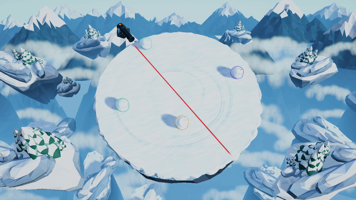
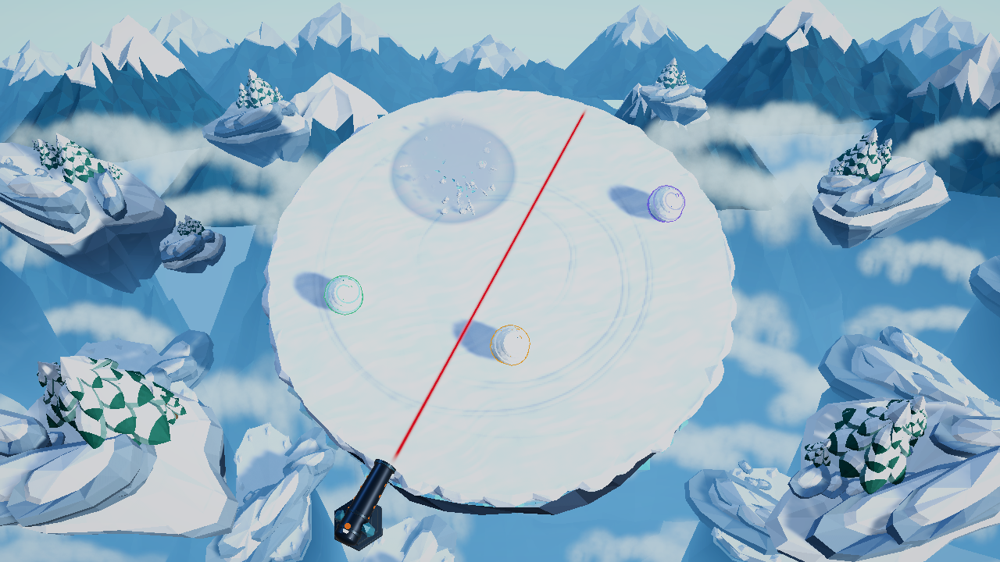

## Overview / 概述

炮弹命中雪球后，原先雪球直接消失，现在播放选定的 **B 冰晶碎裂**：身份色闪光、冷蓝雪雾、雪块与冰晶、地面冲击环和光点，配合短促震屏，总时长约 **1 秒**。视觉尺寸按被击中雪球的半径缩放。

## Changes / 主要变更

- **雪球碎裂效果**：命中前采集雪球位置、半径与身份色，生成一组纯视觉爆炸。默认 B，保留 A 雪雾爆裂与 C 雪崩冲击参数预设；不增加碰撞体、范围伤害或击退。
- **共享实现与资源**：预览和正式比赛共用 `SnowballExplosion.Advance(dt)`；游戏通过 `Update` 驱动，编辑器和包内工具可逐帧推进。Resources 下的雪雾、辉光、雪块和冰晶材质保留 URP 着色器。
- **终局与清理**：终局一击不会随炮台停止而被截断，能够跨越最新 `main` 的胜利演出与结算面板自然播放。菜单和重开立即隐藏旧特效，再等待帧末销毁。
- **构建与验证**：构建入口先验证效果资源和预设，再运行物理回归并打包；扩展 `--cannon-smoke` 与 `--cannon-motion` 验证资源、生命周期和正式命中路径。
- **提交范围**：只保留选定 B 的最终包内预览与报告，三方案比较、慢放、分镜和原始帧保留本地并忽略；保留 Unity 预览入口及 ffmpeg/Pillow 生成脚本以便复现。

## Testing / 测试验证

环境：Windows / Unity **6000.3.28f1** / URP **17.3.0**。已 rebase 到最新上游 `main`（`d574c18`）。

- `CannonBuilder.Build`：**Windows 开发包构建成功**，退出码 0。
- `PrototypeValidation.Run`：**9/9 通过**；`GrowthCollisionValidation.Run`：**22/22 通过**。
- `SnowballExplosionPreview.Validate`：**5/5 组通过**，覆盖三种预设、无碰撞体、同种子确定性、半径缩放与清理。
- 包内 `--cannon-smoke --cannon-motion`：**78/78 通过**，包括三次预警、20/40/60 秒增炮、最近命中、单发单目标、多炮独立换位及新增爆炸检查。终局验证启用 0.3 秒胜利阶段，确认爆炸跨越 `Victory` → `Results` 后自动销毁。
- 包内 `--match-smoke`：**16/16 通过**，覆盖菜单、倒计时、胜负、重开、观战和 16 球对局。自然对局在 **35 个模拟秒**决出胜者，首次碰撞前自行落台的机器人为 **0**。
- 包内导出并检查 **120 帧 / 24 fps / 1280×720** 动效、初始 0.85 m 雪球命中截图；提交范围 `git diff --check` 通过。

## Notes / 备注

- 沿用现有炮击计时、命中扫掠、淘汰和击杀归属规则；保留 `main` 的冬季菜单、玩家光环及胜利演出。
- 提交按功能整理为 **2 个**：Unity 特效、资源与验证；最终预览、生成工具与文档。
- [效果说明与复现命令](art/cannon-snowball-explosion/README.md) · [Windows 完整验证报告](art/cannon-snowball-explosion/windows-validation.txt) · [原速动效 MP4](art/cannon-snowball-explosion/windows-runtime-b.mp4) · [调研依据](art/cannon-snowball-explosion/research.md)。本地 Windows 包位于 `Builds/Windows`，不入 Git。
- 沿用原有炮弹爆炸音；尚未专门验证 16 个爆炸同时出现时的遮挡与性能。批处理不渲染胜利舞台灯光，终局检查覆盖阶段衔接与爆炸生命周期。
