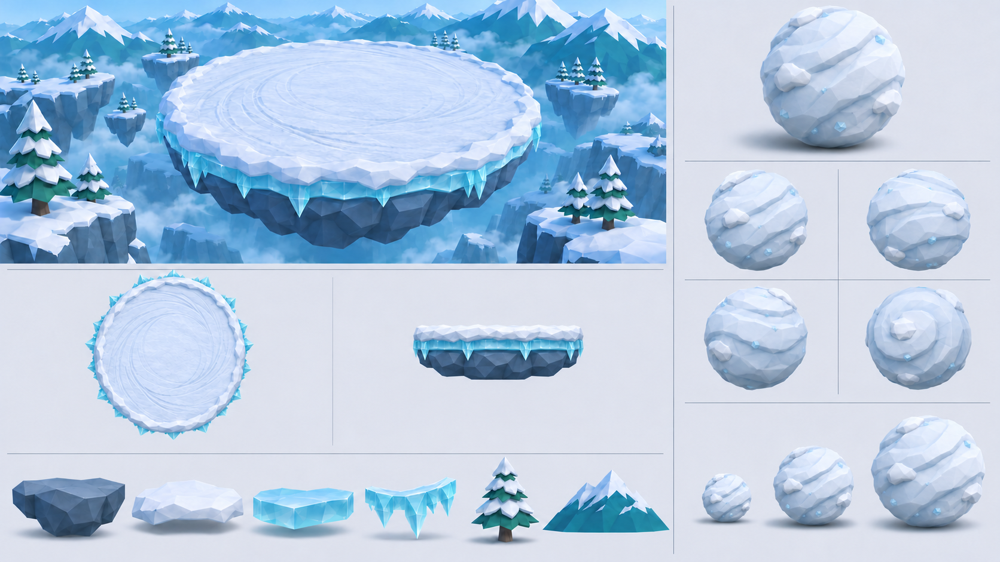
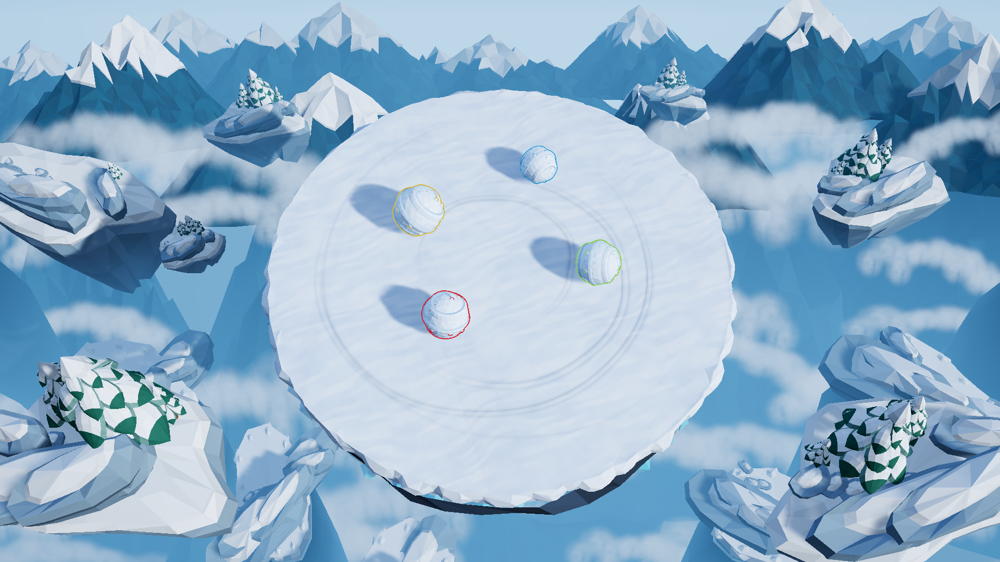

# 雪山竞技场与雪球建模设定

供 Unity URP 低多边形雪球竞技游戏制作环境和雪球模型时参考。平台目标直径约 **22 m**，雪球初始半径约 **0.85 m**。

- [设定图原图](snow-arena-modeling-reference.png)：1672 × 941 像素，约 16:9 横版。
- [生成与修订提示词](snow-arena-modeling-reference-prompt.txt)：保留初始要求及两轮技术视图修订，便于后续迭代。
- 来源：2026-11-09 在项目设计对话中使用内置生图功能生成。

## 图面分区

左侧约三分之二展示竞技场完整场景、平台俯视与侧向分层参考，以及岩石、积雪、冰层、冰晶边缘、雪松和远景山峰六类模块。右侧约三分之一展示雪球的 3/4 透视、正面、侧面、背面、顶视参考，以及小、中、大三个成长阶段。

## 环境建模

- 平台中央保持宽阔、平坦、可滚动和碰撞的连续表面。环形滚动痕迹通过表面材质表现，避免形成影响玩法的凸起或障碍。
- 平台从上到下分为松软白色积雪、半透明浅蓝冰层和厚重深蓝灰岩层。各层轮廓可略有不规则，交界与厚度需要清晰可读。
- 边缘采用可复用的低多边形冰晶段，控制尖角密度，保留完整的平台轮廓。
- 雪松与孤立岩石小岛布置在竞技场外围。远景山峰采用深青蓝山体、白色雪顶和冷色雾气形成层次。
- 岩石、雪帽、冰层、冰晶段、雪松和远景山峰分别制作模块，方便组合、替换与控制场景复杂度。

## 雪球建模

- 基础形体接近球体，轮廓饱满厚重，使用自然、适度的低多边形切面，保证外观适合滚动。
- 以卷入的积雪带、轻微螺旋纹和少量附着雪块表达滚动方向；细小冰晶与浅蓝阴影作为局部细节，避免尖刺和过深裂缝。
- 各方向视图与成长阶段沿用同一套形体和材质语言。最终正交视图应从同一个三维模型导出，确保结构一致。
- 小、中、大仅表达成长的视觉变化，未指定中型和大型的固定半径。具体成长规则以游戏配置和实现为准。
- 球根物体保持 `(1, 1, 1)` 缩放；对接现有 `SnowballBody` 时由其更新球形碰撞半径与视觉子物体尺寸。视觉模型的雪块和纹理细节应围绕球形碰撞体设计。
- 不添加五官、手脚、帽子、装饰物或装备。

## 风格与交付

采用 stylized low-poly、chunky geometric shapes、clean silhouette 和 faceted surfaces，以 Unity URP 与移动端预算为目标。主色为雪白、冰蓝、深青蓝及少量蓝灰岩石色；使用冷色环境光和柔和阴影，保留轻微童话感。

积雪、压实雪球、冰和岩石需要区分 PBR 材质表现：雪偏柔软哑光，雪球更紧实，冰有适度透光感，岩石保持粗粝的块面。以清晰轮廓和大切面为主，避免用密集几何堆叠微小颗粒。

建模交付时分别组织平台结构、外围环境模块与雪球模型，保持统一单位、比例和材质命名。二维设定图用于确定美术方向，平台尺寸、碰撞与出生安全范围需在实际 Unity 场景中核对。

## 游戏内模型

正式对局场景为 [Match.unity](../../Assets/SnowballArena/Scenes/Match.unity)，目前采用已选定的 01 排布。以下图片由保存后重新打开的场景渲染，四颗雪球为出图时的摆放样本。

- [SelectedAlpine01.blend](../../ArtSource/SelectedAlpine01.blend) 保存 43 个独立网格和 68 个模型对象，包含雪松枝团、积雪、分层岩台、裸岩和谷底岩脊。近景与远景按集合组织。
- [Selected01](../../Assets/SnowballArena/Art/Selected01) 保存 Unity 原生网格、材质和模块预制体。[SelectedAlpineEnvironment.prefab](../../Assets/SnowballArena/Art/Selected01/SelectedAlpineEnvironment.prefab) 是正式场景连接的外围地形预制体，可在 Prefab Mode 中编辑模型、树木和排布。
- 主平台、外围岩台及其雪松共用 60° 对战相机。远山和谷雾由 17.5° 背景相机合成。碰撞表面与可视雪层分别挂在主平台下。
- 在 Unity 中执行 **Snowball Arena > Apply Selected Alpine 01** 可把 [SelectedAlpine01.unity](../../Assets/SnowballArena/Scenes/SelectedAlpine01.unity) 的环境应用到正式场景。**Apply Modeling Reference** 也使用该入口。外围地形已有预制体时，使用其已保存的内容。
- **Snowball Arena > Capture Selected Alpine 01** 渲染空台与四球预览，输出到本文的 selected01 图片目录。**Preview Camera Pitch** 打开 Game 窗口的俯角滑块。
- [build_selected_alpine.py](../../Tools/Art/build_selected_alpine.py) 从 [SelectedAlpine01.json.gz](../../ArtSource/SelectedAlpine01.json.gz) 重建 Blender 主文件。运行方式为 `blender --background --factory-startup --python Tools/Art/build_selected_alpine.py -- <项目绝对路径>`。重建会覆盖 Blender 主文件，手工雕刻前可另存版本。Blender 中修改的部件可导出后替换对应预制体的网格。

原来的 [SnowArenaConcept.blend](../../ArtSource/SnowArenaConcept.blend)、[build_concept_assets.py](../../Tools/Art/build_concept_assets.py) 与 Reference 模型仍用于基础雪球和主平台资源。云雾的体积云源文件为 [ValleyCloud.blend](../../ArtSource/ValleyCloud.blend)，由 [bake_valley_cloud.py](../../Tools/Art/bake_valley_cloud.py) 烘焙。

批处理入口 `SnowballArena.Editor.ModelingReferenceBuilder.ApplyAndBuild` 会导入资源、检查碰撞网格与出生位置、执行现有物理验证并构建 `Builds/Windows/SnowballArena.exe`。`BuildConceptPreview` 验证当前场景并构建 `Builds/ConceptPreview/SnowballArena.exe` 开发包，`BuildPlayablePreview` 输出同路径的普通试玩包；`ConceptAssetStudio.Render` 生成独立单体预览。预览与资源检查报告输出到被 Git 忽略的 `TestResults/ConceptMatch`。
