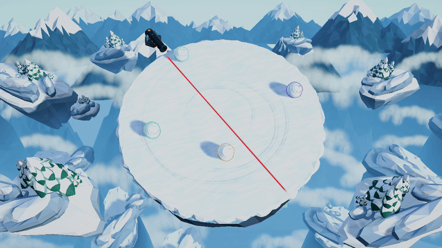

# 大炮击中雪球：B 冰晶碎裂

2026-11-11 · 分支 `feat/cannon-snowball-explosion-preview` · 已 rebase 到 `main`（`d574c18`），选定 B 并完成 Windows 包验证。



[Windows 包动效 MP4](windows-runtime-b.mp4) · [命中截图](windows-runtime-b.png) · [Windows 验证报告](windows-validation.txt)

## 选定表现

炮弹命中后，从雪球当前位置采集半径和身份色，生成闪光、冷蓝雪雾、雪块与冰晶、地面冲击环和光点，追加短促震屏。默认 `CannonDirector.snowballExplosionStyle = IceShatter`：84 个雪雾元素、56 块碎块（含 14 块冰晶）、40 个光点，总时长 1 秒。

所有长度、速度和碎块尺寸按被击中雪球的半径缩放。效果只负责视觉，不增加 Collider、Rigidbody 或伤害判定。预览与正式比赛共用 `SnowballExplosion.Advance(dt)`，正式比赛由 `Update` 推进。

| 阶段 | 时间 | B 冰晶碎裂表现 |
| --- | --- | --- |
| 起爆 | 0–40 ms | 身份色闪光和冷蓝雪雾覆盖雪球轮廓 |
| 主扩散 | 40–200 ms | 冰晶、雪块飞散，地面冲击环展开 |
| 余韵 | 200–700 ms | 碎块弹跳并缩小，雪雾逐渐淡出 |
| 清理 | 700–1000 ms | 余下元素消失，自动销毁对象 |

`CannonDirector` 的 Inspector 保留 A 雪雾爆裂（0.90 s）和 C 雪崩冲击（1.05 s）供比较；C 追加 28 ms 顿帧。参数集中在 `SnowballExplosion.Profiles`，调研依据见 [research.md](research.md)。

## 与最新 main 的兼容

保留 `main` 的冬季菜单、玩家光环与胜利演出。终局炮击停止炮台后，爆炸仍可跨越 `Victory` 和 `Results` 两个阶段自然播放并清理；重开或返回菜单会立即隐藏旧爆炸，再等待帧末销毁，避免残影。

包内验证使用 0.3 秒胜利阶段以覆盖演出到结算的切换；正式对局仍使用 `main` 的胜利时长。批处理模式不渲染胜利舞台灯光，因此该检查验证的是阶段衔接与生命周期。

## 构建与验证

**Snowball Arena > Build Cannon Game** 会准备并验证 Resources 材质、着色器与三种效果预设，再执行既有物理回归并构建 Windows 开发包。

- Windows 构建成功，基础物理 **9/9**、成长与碰撞 **22/22**。
- 效果编辑器验证 **5/5 组**，覆盖三种预设、同种子确定性、按半径缩放、无碰撞体与清理；见 [validation.txt](validation.txt)。
- Windows 包炮台与爆炸检查 **78/78**，包括资源与着色器、默认 B、单次生成、菜单即时隐藏、胜利演出到结算的衔接和自动注销。
- Windows 包对局检查 **16/16**，覆盖菜单、开局、胜负、重开、观战和 16 球对局；自然对局 35 个模拟秒决出胜者，首次碰撞前自行落台的机器人为 0。
- 包内逐帧导出 **120 帧 / 24 fps / 1280×720**，包含三次预警、命中和消散。截图使用初始 0.85 m 雪球，起爆后 0.20 秒。

完整报告见 [windows-validation.txt](windows-validation.txt)。本地可执行文件是 `Builds/Windows/SnowballArena.exe`，运行或复制时保留完整 `Builds/Windows` 目录。

在仓库根目录复现：

```powershell
$unityJob = Start-Process 'D:/Unity/Editors/6000.3.28f1/Editor/Unity.exe' -ArgumentList '-batchmode -quit -projectPath E:/XYLGameJam/snowball-rolling -executeMethod SnowballArena.Editor.CannonBuilder.Build -logFile Logs/explosion-b-rebase-build.log' -WindowStyle Hidden -Wait -PassThru
if ($unityJob.ExitCode -ne 0) { throw 'Unity build failed' }
$playerJob = Start-Process './Builds/Windows/SnowballArena.exe' -ArgumentList '-batchmode -screen-width 1280 -screen-height 720 -screen-fullscreen 0 --cannon-smoke E:/XYLGameJam/snowball-rolling/TestResults/ExplosionB-Rebase --cannon-motion -logFile E:/XYLGameJam/snowball-rolling/Logs/explosion-b-rebase-player.log' -WindowStyle Hidden -Wait -PassThru
if ($playerJob.ExitCode -ne 0) { throw 'Cannon smoke failed' }
```

## 设计输出与生成工具

仓库只提交选定 B 的包内 GIF、MP4、截图及说明和验证报告。三方案比较图、各方案慢放视频、分镜、原始帧、片段清单与编码报告均保留在本地，由 `.gitignore` 排除。

需要重做完整三方案预览时，使用 Unity 菜单 **Snowball Arena > Preview Snowball Explosion**，或运行：

```powershell
& 'D:/Unity/Editors/6000.3.28f1/Editor/Unity.exe' -batchmode -quit -projectPath E:/XYLGameJam/snowball-rolling -executeMethod SnowballArena.Editor.SnowballExplosionPreview.Render -logFile Logs/snow-explosion-render.log
python Tools\Art\present_snowball_explosion.py . --ffmpeg D:/Tools/VideoTools/imageio_ffmpeg/binaries/ffmpeg-win-x86_64-v9.0.2.exe --gif-width 720 --gif-fps 15
```

工具使用正式 `Match.unity`、雪球和炮弹资源确定性逐帧渲染，由 ffmpeg 与 Pillow 编码。原三方案共 7 段、718 帧；该设计阶段出图保留在本地，不作为最新 `main` 的验证证据。

## 限制

- 沿用现有炮弹爆炸音，未新增独立雪球爆裂音。
- 包内回归覆盖初始 0.85 m 雪球，编辑器验证覆盖半径缩放；尚未专门验证 16 个爆炸同时出现时的遮挡与性能。
- A/C 保留作调参预设，正式默认使用 B。
