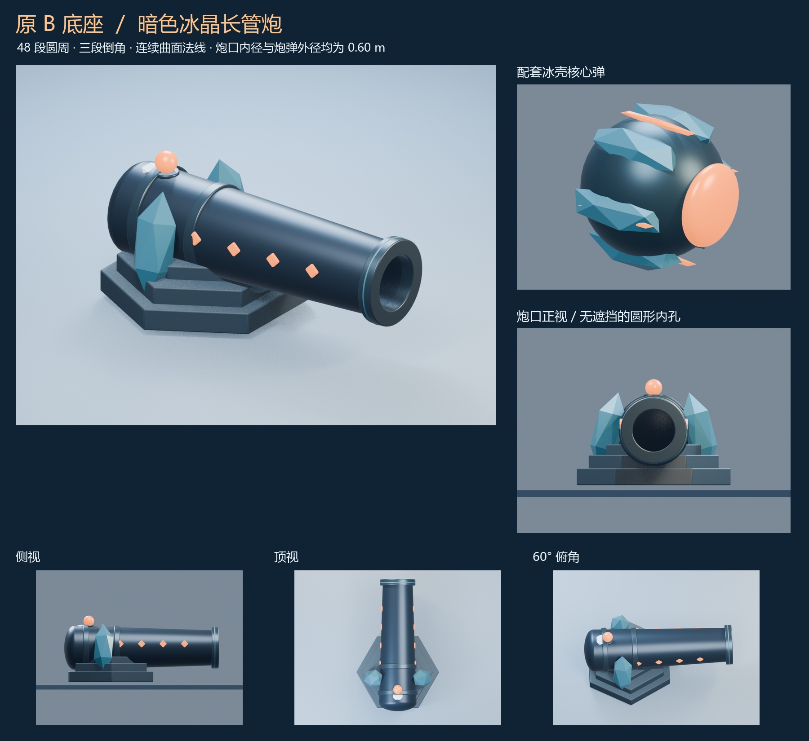
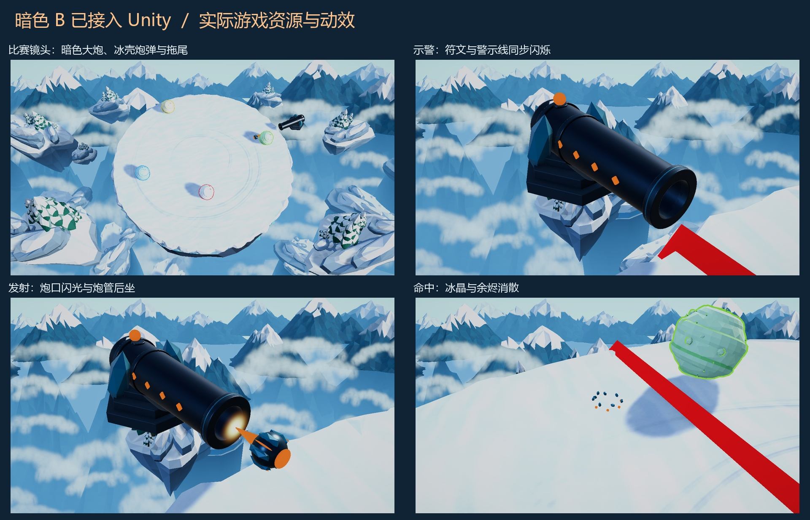
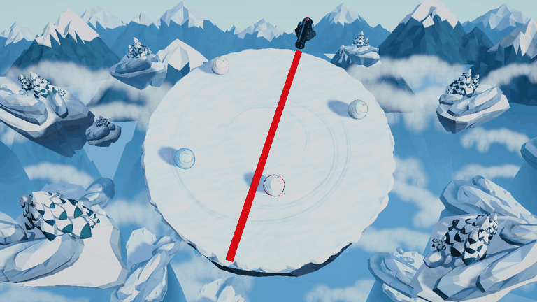

# 暗色 B 底座长管炮与炮弹

2026-11-11。当前分支 `fix/cannon-models-and-projectile-visibility`。按本次选型与后续修改，采用原 B 底座、加长和加厚炮管，接入暗色冰晶长管炮与冰壳核心弹，并修复炮弹显示、补齐飞行动效。



主体采用深蓝黑金属、深青冰晶、少量残雪与橙色符文，保留原 B 的三层六角岩冰底座和两侧冰晶支撑，只将炮管加长、炮尾加厚并改为圆弧，让比例更接近加农炮。炮管约 3.21 m 长，整体长约 3.55 m，底座最大宽度约 2.20 m；没有添加轮式炮架或拖架。炮管、炮口和箍环采用 **48 段圆周**，加入三段倒角、平滑曲面法线与细环饰边。炮弹主体球面从 80 个三角面细化为 1,280 个三角面，橙色端面改用 48 段的圆弧球面，冰晶护壳保留切面造型。

炮口有效内径与炮弹外径统一为 **0.60 m**。圆口内壁保留 0.30 m 内切半径，入口倒角向外展开，不挤占炮弹通道。底座与冰座设有圆弧承托槽，支撑面不会遮挡炮孔。实际烘焙网格验证内径约为 0.600000 m；炮弹所有顶点在 0.30 m 物理半径以内。炮口标记位于模型局部 `(0, 0.8, 2.00)`，运行时按它对齐既有飞行起点。

## 游戏内表现





[实机视频](gameplay-motion.mp4)使用正式比赛场景和实际资源，以 24 fps 记录三次预警、发射、直线飞行和命中，按游戏原速播放。诊断相机图不含 OnGUI。工作室模型图由 Blender 渲染，实机图由 Unity 渲染。

- 深色炮台、炮弹和预警线均由比赛相机绘制，不再误用远景 layer 2。
- 符文和顶部灯随红色预警线亮灭三次。
- 发射时出现约 0.07 s 的柔边圆形辉光，使用渐隐透明效果，不再显示低面数的橙色多边形块；炮管后坐约 0.12 m，在 0.22 s 内复位。
- 冰壳炮弹沿既有路径飞行并旋转，橙色短尾最长约 2.16 m，只显示已经飞过的路径。
- 命中时炮弹立即清除，冰晶和余烬碎片在 0.30 s 内缩小消散。碎片是纯视觉效果，没有碰撞体、击退或范围伤害。
- 对局结束、重开和返回菜单清除全部炮台、炮弹和附属动效。各炮台独立计时和换位。

20/40/60 秒升级、三次预警、18 m/s 速度、0.30 m 碰撞半径、最近目标扫掠检测与单发单目标规则沿用原实现。模型和动效不改变平台碰撞、出生位置或雪球运动。

## 源文件与资源

- [SelectedCannonB.blend](../../../ArtSource/SelectedCannonB.blend)：可编辑模型，炮体、炮弹、工作室与动效网格分集合保存。
- [SelectedCannonB-motion.blend](../../../ArtSource/SelectedCannonB-motion.blend)：Blender 慢速动效研究；游戏中的后坐、闪光、旋转和碎片由实际游戏时钟驱动。
- [SelectedCannonB.json.gz](../../../ArtSource/SelectedCannonB.json.gz)：从 Blender 评估后的网格导出，保留倒角和每个面的分裂法线，并将 +X 炮口方向转换为 Unity +Z。
- [SelectedCannonB](../../../Assets/SnowballArena/Art/SelectedCannonB)：7 个 Unity 原生网格、材质和三个预制体（大炮、炮弹、命中碎片），炮台、炮弹及一组碎片合计 18,596 个三角面，通过预算检查。
- [CannonArt.asset](../../../Assets/SnowballArena/Resources/CannonArt.asset)：Resources 资源入口，普通 Windows 构建也会包含所需预制体和着色器。

建模使用 Blender 4.5.15，渲染使用 Eevee；未使用 imagegen。Unity 导入时将 Blender 线性材质色转换为 Unity 材质属性使用的 sRGB 色，避免深色主体在游戏里丢失层次。圆口、主体曲面和倒角的自定义法线保留到 Unity。

## 重建与验证

脚本重建会覆盖生成的 Blender 源文件、导出数据和研究图片。手工修改源文件前请另存版本。

```powershell
& 'D:/Tools/Blender/blender-4.5.15-windows-x64/blender.exe' --background --factory-startup --python Tools/Art/build_cannon_concepts.py -- E:/XYLGameJam/snowball-rolling --selected --animate
& 'D:/Unity/Editors/6000.3.28f1/Editor/Unity.exe' -batchmode -quit -projectPath E:/XYLGameJam/snowball-rolling -executeMethod SnowballArena.Editor.CannonAssetBuilder.ImportAndBuild -logFile Logs/cannon-build.log
& './Builds/Windows/SnowballArena.exe' -batchmode --cannon-smoke E:/XYLGameJam/snowball-rolling/TestResults/SelectedCannonB/Smoke --cannon-motion -logFile Logs/cannon-smoke.log
python Tools/Art/present_selected_cannon.py E:/XYLGameJam/snowball-rolling --ffmpeg D:/Tools/VideoTools/imageio_ffmpeg/binaries/ffmpeg-win-x86_64-v9.0.2.exe
```

编辑器菜单 **Snowball Arena > Rebuild Selected Cannon B** 仅重建原生资源，不改正式场景。验证检查实际内孔几何、炮弹半径、持久化网格、无额外碰撞体和三角面预算。

Windows 开发包构建成功；`--cannon-smoke` 的 **53 项检查通过**，覆盖原有炮击规则及模型资源、炮口对齐、内径一致、示警同步、炮口闪光、后坐、拖尾、消散与清理。资产几何报告位于 `TestResults/SelectedCannonB/assets.txt`，运行时报告和原始图片位于 `TestResults/SelectedCannonB/Smoke`。
